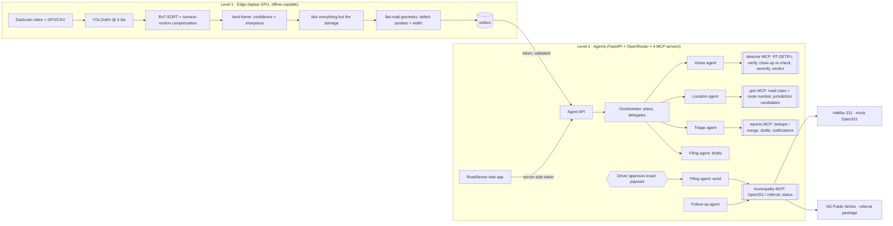

# RoadSense

**AI agents that find road damage from a dashcam and get it to the road authority that can fix it.**

Cognizant BrAInstorm Challenge 2026 · Agentic AI for Good · tracks: Public Services, Sustainability

Halifax logged 3,203 pothole reports between January 1 and March 19, 2026, and says the count includes the same
pothole reported several times and potholes on provincial roads it does not maintain (CityNews, via an aggregator;
to be checked against the original). RoadSense attacks exactly that: a dashcam finds the damage, and a team of AI
agents confirms it, works out **who** is responsible, merges repeat sightings into one report, and files it once the
driver approves.

A dashcam video and its GPS track go through a YOLOv8m detector on the edge device (a laptop GPU). Only
privacy-blurred frames of damage leave the vehicle. LLM agents, connected to their tools through the **Model Context
Protocol (MCP)**, decide what each detection is, who maintains that road, whether it is already reported, and what
the authority is told; the driver approves the exact payload; a follow-up agent tells the driver when it is fixed.

## Architecture



### Decisions the agents make (and the trace shows why)

| Decision | Evidence it acts on | Guard in code |
|---|---|---|
| **Real damage, false alarm, or disputed?** | RT-DETR-L verification on the redacted frame, close-up re-check for confident unconfirmed detections | Can't confirm without verifier evidence; "disputed" only when the two models disagree on class. YOLOv8m's label is kept and the driver is asked. |
| **Who maintains this road?** | OpenStreetMap road class and route number: 100-series highways → Nova Scotia Public Works; numbered routes through the city are ambiguous and the agent weighs them; local streets → HRM | Only authorities in the directory have a delivery channel |
| **New report or another sighting of a known one?** | Open reports of the same class within 15 m of the projected position | Merging is idempotent; confirmations raise priority |
| **What the authority is told** | Report facts: class, width band, HRM Priority 1 candidate, confirmations, address | Text is sanitised, and locked by hash once the driver approves |
| **Is it fixed?** | Authority status feed | Notifies each driver once |

The fallback that completes any skipped step is a circuit breaker, not the engine: its use is counted and reported
per trip as the fallback rate.

## Measured results

All on held-out RDD2022 data (roads no model saw in training), reproducible with the scripts named.

**Detectors** (training repo, test split, thresholds tuned on validation)

| Model | Role | F1 | mAP@0.5 | Pothole AP | Latency (GTX 1650 Ti) |
|---|---|---:|---:|---:|---:|
| YOLOv8m | edge detector | 0.590 | 0.599 | 0.509 | 36 ms |
| RT-DETR-L | cloud verifier | 0.614 | 0.613 | 0.540 | 71 ms |

**Vision verification** (`scripts/eval_verifier.py`: rule tuned on 350 validation images, reported once on 350 test
images, 568 labelled defects, `results/verifier_eval.json`)

| | Edge only | After verification |
|---|---:|---:|
| Precision (detection overlaps a labelled defect) | 0.714 | **0.744** |
| False alarms | 146 | **115 (−21%)** |
| True damage kept | 364 | 335 (92%) |

12% of kept detections get a class dispute between the two models, which goes to the driver instead of being
silently overwritten. The gain is modest because both models learned from the same data and share blind spots, and
part of the "false alarms" are unlabelled real damage. Multi-driver confirmation is the stronger filter.

**Agent decisions** (`scripts/eval_agents.py`: 42 scenarios from labelled test images through the real MCP servers,
deterministic mode, `results/agent_eval.json`)

| Metric | Result |
|---|---:|
| Jurisdiction (Highway 102 → province, local streets → HRM) | 100% (30/30) |
| Duplicate sightings merged instead of re-filed | 100% (6/6) |
| Real damage turned into reports | 100% (24/24) |
| Unlabelled detections rejected | 17% (2/12) |
| Sent to an authority without approval / tool outside allow-list | 0 / 0 |
| Processing time | 9 s for 36 events |

**Live LLM agents** (`scripts/eval_agents.py --llm --singles 10`: 17 scenarios, free `nvidia/nemotron-3-ultra-550b-a55b`,
`results/agent_eval_llm.json`)

| Metric | Result |
|---|---:|
| Jurisdiction / duplicate merging / real damage reported | 100% / 100% / 100% |
| Unlabelled detections rejected | 1 of 5 |
| Fallback rate (steps the agents left for the circuit breaker) | **0%** |
| Sent without approval / tool outside allow-list | 0 / 0 |
| LLM calls per trip | 19 (15 events), 17 (2 events) |
| Tokens per trip | 102k (15 events), 32k (2 events) |
| Time per trip | 214 s, 93 s |
| Answers that failed the output schema and self-corrected | 2 |

The agents cite their evidence in every decision ("RT-DETR-L confirms D00 at confidence 0.90 with IoU 0.89, class
agrees"), and routed Highway 102 with "a 100-series provincial highway (NS 102), maintained by Nova Scotia Public
Works". One weakness to watch: the orchestrator's driver summary miscounted severities once (said 6 medium, listed 7);
the numbers in the reports themselves come from the database, not from the summary.

Free-tier budget: a 15-event trip uses about 19 of the 50 free requests a day (1,000 a day after a one-time $10
credit purchase). `scripts/smoke_llm.py` showed both Nemotron models returning correct tool calls; Gemma's free
endpoint was rate-limited upstream, so it is last in the fallback chain.

**Edge** (`clips/us_drive.mp4`, 60 test stills with simulated forward motion, 142 labelled defects): YOLOv8m with
BoT-SORT analysed 5 frames/s of video at 17.8 FPS and produced 84 events (ByteTrack: 66 events at 35.4 FPS). A road
crop that skips the top 35% of the frame lowered recall from 0.64 to 0.53 on the test split, so it is off by default.

## What is real and what is mocked

| Real | Mocked or simulated |
|---|---|
| YOLOv8m and RT-DETR-L trained on RDD2022; verification, tracking, redaction, geometry | Test videos are RDD2022 stills with simulated motion; a recorded Halifax drive is next |
| OpenStreetMap reverse geocoding (Nominatim), road class and route numbers | Offline fixture for two Halifax roads when there is no network |
| Road snapping: each defect is moved to the nearest drivable road (OSRM, within 25 m) | The public OSRM demo server is for development; run your own for a pilot |
| The simulated drive follows real street geometry (OSRM route over OpenStreetMap, `roadsense/edge/halifax_route.json`) | |
| MCP servers, agent loop, OpenRouter client, approvals, audit log | **HRM has no public Open311 API**: reports go to a local mock GeoReport v2 server |
| | Nova Scotia Public Works gets a referral package (JSON), not a live submission |
| | Camera height, pitch and field of view are defaults until calibrated per vehicle |

## Setup

Python 3.11 and an NVIDIA GPU (CPU works, slower).

```bash
python -m venv .venv
.venv\Scripts\activate                      # Linux/macOS: source .venv/bin/activate
pip install torch==2.7.1 torchvision==0.22.1 --index-url https://download.pytorch.org/whl/cu118
pip install -r requirements.txt
copy .env.example .env                       # Linux/macOS: cp .env.example .env
```

In `.env`:
- `OPENROUTER_API_KEY`: free key from openrouter.ai. The free tier allows 50 requests a day, or 1,000 a day after a
  one-time $10 credit purchase; a trip takes roughly 8-15 requests. Without a key the deterministic pipeline runs.
- `ROADSENSE_LLM_MODELS`: free tool-calling models in fallback order. Check them with `python scripts/smoke_llm.py`.
- `ROADSENSE_LLM_MODE`: `cache` (default) stores every response, so reruns cost nothing; `replay` serves a recorded
  run without a key (keyless demo).
- `ROADSENSE_WEIGHTS_DIR`: folder with `yolov8m_rdd2022.pt` and `rtdetr_l_rdd2022.pt` from the training repo.
- `ROADSENSE_CAMERA_*`: dashcam height, pitch and field of view, used to place and size detections.
- Change `ROADSENSE_API_TOKEN` and `ROADSENSE_OPEN311_API_KEY`.

## Run

```bash
python scripts/run_all.py        # mock 311 :8311, agent API :8000 (/docs), web app :7860
```

or `docker compose up --build` (CPU image; not yet tested here).

### The web app (http://127.0.0.1:7860)

A SaaS-style single-page app (FastAPI + vanilla JS, light and dark themes, no build step), designed from the
research synthesis in [docs/research-synthesis.md](docs/research-synthesis.md):

| Page | What it is for |
|---|---|
| **Overview** | Outcome funnel (detections → confirmed → unique reports → sent), duplicates merged, false alarms removed, routed to the province, Priority 1 candidates, repairs confirmed, agent cost, latest decisions, mini map |
| **Trips** | Upload a dashcam video (+ GPX/CSV, or a simulated Halifax route); live progress through edge → upload → agents; detections gallery; "Process now" for uploaded-but-unprocessed trips |
| **Review** | The approval inbox: photo, flags (P1 candidate, class disputed, N drivers), the agents' decision timeline, and the exact payload locked by SHA-256. Sending always needs a click |
| **Reports** | All reports with status filters and a detail page |
| **Map** | Leaflet map (vendored) coloured by status, sized by independent drivers |
| **Agent activity** | Every plan, verdict and tool call, filterable by agent and trip |
| **Authorities** | Halifax 311 (Open311) requests, NS Public Works referrals, Follow-up agent, driver notifications |
| **Trust & system** | Guardrails, privacy, model and quota, MCP servers and tools |

The browser never sees the API token: the web server holds it and exposes a fixed set of calls.

## Keyless demo

```bash
python scripts/demo.py            # replays a real recorded agent run on the fixed demo trip: no API key needed
python scripts/demo.py --record   # re-record it live (needs OPENROUTER_API_KEY, ~17 free-tier requests)
```

The demo trip (`demo/trip/`) covers every decision: real damage on Halifax streets, Highway 102 routed to Nova
Scotia Public Works, an ambiguous numbered route, a disputed class, and a second driver's sighting that merges. Each run
starts from a fresh `data/demo` folder with offline geocoding, so the agents see the same tool results as when the run
was recorded. Browse the result with `ROADSENSE_DATA_DIR=data/demo ROADSENSE_OFFLINE_GEO=1 python scripts/run_all.py`.

## Evidence

```bash
python scripts/check.py                                   # ruff + 38 tests + pip-audit (no known vulnerabilities)
python scripts/eval_verifier.py --split <RDD>/val --tune  # choose the verification rule on validation data
python scripts/eval_verifier.py --split <RDD>/test        # report it once on test
python scripts/eval_agents.py [--llm]                     # 42 decision scenarios end to end
python scripts/smoke_llm.py                               # does each free model really call tools?
```

Security and privacy: see [SECURITY.md](SECURITY.md) (threat model, OWASP Agentic Top 10 mapping, PIPEDA/PIIDPA notes).

## Project layout

```
roadsense/
  common/       config, detectors, SQLite schema (+ migrations, append-only audit), edge→API schema
  edge/         gps, camera geometry, tracker (BoT-SORT config), redact, process_video, outbox, simulate_gps, make_clip
  core/         verdict + severity + dedupe rules, verification, geocoding + jurisdiction, authority directory + payloads
  mcp_servers/  detector, geo, reports, municipality (FastMCP, stdio, annotated tools)
  agents/       OpenRouter client (fallback chain, rate limit, cache/replay), MCP toolbox, typed contracts,
                specialists, orchestrator, circuit-breaker fallback
  services/     agent API (FastAPI), mock Open311 server
  web/          web app: backend-for-frontend (FastAPI) + single-page app in static/ (vanilla JS, vendored Leaflet)
scripts/        run_all, check, eval_verifier, eval_agents, smoke_llm, list_free_models
```

## Roadmap

- Recorded replay of a full trip for the keyless demo (needs ~20 requests of free quota)
- Recorded Halifax drive with a phone GPS log; calibrate the camera; tape-measure potholes to validate widths
- Direction-aware dedupe (DBSCAN/H3) and "confirmed" only after two independent drivers
- Postgres + PostGIS, a job queue, MCP over Streamable HTTP for horizontal scaling; Canadian hosting (PIIDPA)

## Team

Rahul Raj · [teammate]
