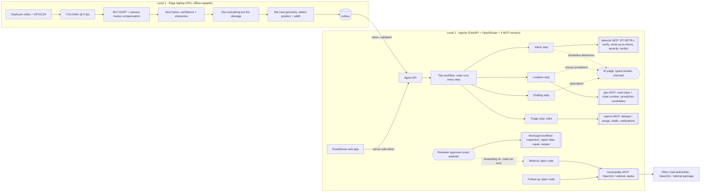

# RoadSense

**The municipality's own system for road damage: AI agents find it from a dashcam, and staff take each report from
review through inspection to a repair that RoadSense checks on its own.**

Cognizant BrAInstorm Challenge 2026 · Agentic AI for Good · tracks: Public Services, Sustainability

Halifax logged 3,203 pothole reports between January 1 and March 19, 2026, and says the count includes the same
pothole reported several times and potholes on provincial roads it does not maintain
([CTV Atlantic](https://www.ctvnews.ca/atlantic/nova-scotia/article/more-potholes-in-halifax-this-year-compared-to-2024-municipality-says/)).
RoadSense attacks exactly that: a dashcam finds the damage, and a team of AI
agents confirms it, works out **who** owns the road, and merges repeat sightings into one report. Municipal staff then
run the rest inside RoadSense: review, inspection, a repair decision with a date, the repair, and a reopen when the
repair did not hold. Nothing is sent anywhere by default.

A dashcam video and its GPS track go through a YOLOv8m detector on the edge device (a laptop GPU). Only
privacy-blurred frames of damage leave the vehicle. LLM agents, connected to their tools through the **Model Context
Protocol (MCP)**, decide what each detection is, who maintains that road, whether it is already reported, and what
the report says; a reviewer approves the exact payload. Only people move a report after that.

## The repair workflow

```
Awaiting review ──reject──▶ Closed (Rejected)
      │ approve
Awaiting inspection ──assign inspector──▶ Inspection assigned ──no repair needed──▶ Closed (Repair not needed)
                                                │ repair needed (+ estimated repair date)
                                          Repair needed ──mark repaired──▶ Repaired ──seen again / reopened──▶ Reopened
                                                                              │ clean passes on later trips      │ new date
                                                                     Repaired (verified)                Repair needed
```

One state machine (`roadsense/core/workflow.py`) holds the statuses, which role may take each step and what each step
needs; it is the only code that changes a report's status, and every step is written to the report's hash-chained
ledger with who and when. Roles: **reviewer** (approve, reject, assign, and any step), **inspector** (record the
outcome of inspections assigned to them, mark them repaired, reopen), **admin**. Three inspectors, Inspector 1, 2 and 3,
are created on first start for the assign dropdown; they have no password, so a reviewer or admin records the outcome
for them (set a password on the Users page to let one sign in). Inspections are tracked on the Reports page:
**Inspection assigned**, then **Repair needed** or **Closed (Repair not needed)**. A report past its estimated repair
date is **overdue** and is flagged on lists, the map and the overview. The service-standard clock starts at approval
and follows these steps (see [docs/service-standards.md](docs/service-standards.md)).

Referral to another authority (Open311, Cityworks, ArcGIS or a referral package) is optional:
`ROADSENSE_FORWARD_MODE=on` refers approved reports on roads another authority owns (compared with
`ROADSENSE_MUNICIPALITY`, default Halifax Regional Municipality). It is off by default.

## Architecture



### How the AI is used

A code workflow runs every step of a trip; the model is asked only where judgement adds something, in batches of up
to 8 items, and never calls tools itself. Each step uses its own allow-listed MCP tools (enforced in code), hands the
model the evidence as data, and checks its typed answer: an answer about an id it was not asked about, or a choice
outside the candidates, is dropped and the rule decides. If the model becomes unavailable, the rules finish the trip.

| Step | Rule | Where the AI judges |
|---|---|---|
| Vision | verifier support confirms; a class disagreement is "disputed"; no support is a false alarm | confirmations on weak evidence (verifier confidence < 0.65, ≤ 2 frames, box overlap < 0.3, or close-up re-check only): keep or reject |
| Location | top-ranked authority from road class and route number | numbered routes where the candidates tie |
| Triage | merge within 15 m or create a report | never |
| Drafting | standard template | writes the description the authority reads |
| Filing, follow-up | plain code after approval / on a schedule | never |

### Decisions the system makes (and the trace shows why)

| Decision | Evidence it acts on | Guard in code |
|---|---|---|
| **Real damage, false alarm, or disputed?** | RT-DETR-L verification on the redacted frame, close-up re-check for confident unconfirmed detections | Can't confirm without verifier evidence; "disputed" only when the two models disagree on class. YOLOv8m's label is kept and the driver is asked. |
| **Who maintains this road?** | OpenStreetMap road class and route number: 100-series highways → Nova Scotia Public Works; numbered routes through the city are ambiguous and the agent weighs them; local streets → HRM | Only authorities in the directory have a delivery channel |
| **New report or another sighting of a known one?** | Open reports of the same class within 15 m of the projected position | Merging is idempotent; confirmations raise priority |
| **What the report says** | Report facts: class, width band, severity, confirmations, address | Text is sanitised, and locked by hash once the reviewer approves |
| **Is it fixed?** | Authority status feed | Notifies each driver once |
| **Is it really fixed?** | Later trips past a closed report: the defect detected again, or clean frames of the spot | The authority's status is kept; RoadSense reopens on a confident re-detection and verifies only after clean passes from 2 different trips. Blurred, dark, out-of-view or weak evidence is inconclusive |

The fallback that completes any skipped step is a circuit breaker, not the engine: its use is counted and reported
per trip as the fallback rate.

### Independent repair verification

An authority closing a request does not prove the pothole was filled. When the follow-up feed (or the city's own
request layer) closes a report, RoadSense keeps that status as "Closed" and marks the report **awaiting
verification**. Later trips re-observe it (`roadsense/core/repair.py`):

- **Seen again**: a verified detection of a compatible class within `ROADSENSE_REPAIR_MATCH_RADIUS_M` (15 m), on the
  same road, captured after the closure. At or above `ROADSENSE_REPAIR_REDETECT_CONFIDENCE` (0.5) the repair is
  **not verified** and the report is **Reopened**, with the reason and the new photo. Below it, the result is
  **inconclusive**. The sighting is attached to the closed report instead of opening a duplicate.
- **Not seen**: the edge downloads a watchlist of closed reports and keeps one privacy-blurred frame of each spot it
  passes (`roadsense/edge/reobserve.py`). A frame counts as a clean pass only when it is sharp, lit, shows the spot
  4-25 m ahead within 35° of the heading, and that trip detected nothing of that class there. The repair is
  **verified** after `ROADSENSE_REPAIR_MIN_CLEAN_PASSES` (2) clean passes from different trips. One miss is not proof.

Every attempt is stored once in an append-only history (`repair_verifications`) with a SHA-256 evidence hash and
audit events. The report page shows the original and latest follow-up photos side by side. The overview shows the
**Repair Verification Rate** = verified ÷ (verified + reopened) × 100. Closed reports nobody has driven past yet, and
those with only inconclusive frames, are counted separately and never as failed repairs.

## Measured results

All on held-out RDD2022 data (roads no model saw in training), reproducible with the scripts named.

**Detectors** (training repo, test split, thresholds tuned on validation)

| Model | Role | F1 | mAP@0.5 | Pothole AP | Latency (GTX 1650 Ti) |
|---|---|---:|---:|---:|---:|
| YOLOv8m | edge detector | 0.590 | 0.599 | 0.509 | 36 ms |
| RT-DETR-L | cloud verifier | 0.614 | 0.613 | 0.540 | 71 ms |

**Vision verification** (`scripts/eval_verifier.py`: rule tuned on 350 validation images, reported once on 350 test
images, 568 labelled defects, `results/verifier_eval.json`)

| | Edge only | After verification |
|---|---:|---:|
| Precision (detection overlaps a labelled defect) | 0.714 | **0.744** |
| False alarms | 146 | **115 (−21%)** |
| True damage kept | 364 | 335 (92%) |

12% of kept detections get a class dispute between the two models, which goes to the driver instead of being
silently overwritten. The gain is modest because both models learned from the same data and share blind spots, and
part of the "false alarms" are unlabelled real damage. Multi-driver confirmation is the stronger filter.

**Agent decisions** (`scripts/eval_agents.py`: 42 scenarios from labelled test images through the real MCP servers,
deterministic mode, `results/agent_eval.json`)

| Metric | Result |
|---|---:|
| Jurisdiction (Highway 102 → province, local streets → HRM) | 100% (30/30) |
| Duplicate sightings merged instead of re-filed | 100% (6/6) |
| Real damage turned into reports | 100% (24/24) |
| Unlabelled detections rejected | 17% (2/12) |
| Sent to an authority without approval / tool outside allow-list | 0 / 0 |
| Processing time | 9 s for 36 events |

**With the AI judge** (`scripts/eval_agents.py --llm --singles 10`: 17 scenarios, free
`nvidia/nemotron-3-ultra-550b-a55b`, `results/agent_eval_llm.json`). The table below is the earlier design, where free-
running agents ran every step. The workflow design on the same scenarios: report precision 0.714 → 0.769, unlabelled
detections rejected 1 of 5 → 2 of 5, real damage, jurisdiction and merging unchanged at 100%, 36 → 5 model calls,
134k → 8k tokens, 307 s → 70 s for the two trips. A small sample: treat the precision gain as a direction, not a
measurement.

| Metric | Result |
|---|---:|
| Jurisdiction / duplicate merging / real damage reported | 100% / 100% / 100% |
| Unlabelled detections rejected | 1 of 5 |
| Fallback rate (steps the agents left for the circuit breaker) | **0%** |
| Sent without approval / tool outside allow-list | 0 / 0 |
| LLM calls per trip | 19 (15 events), 17 (2 events) |
| Tokens per trip | 102k (15 events), 32k (2 events) |
| Time per trip | 214 s, 93 s |
| Answers that failed the output schema and self-corrected | 2 |

The agents cite their evidence in every decision ("RT-DETR-L confirms D00 at confidence 0.90 with IoU 0.89, class
agrees"), and routed Highway 102 with "a 100-series provincial highway (NS 102), maintained by Nova Scotia Public
Works". One weakness to watch: the orchestrator's driver summary miscounted severities once (said 6 medium, listed 7);
the numbers in the reports themselves come from the database, not from the summary.

Free-tier budget: a 15-event trip uses about 19 of the 50 free requests a day (1,000 a day after a one-time $10
credit purchase). `scripts/smoke_llm.py` showed both Nemotron models returning correct tool calls; Gemma's free
endpoint was rate-limited upstream, so it is last in the fallback chain.

**Edge** (`clips/us_drive.mp4`, 60 test stills with simulated forward motion, 142 labelled defects): YOLOv8m with
BoT-SORT analysed 5 frames/s of video at 17.8 FPS and produced 84 events (ByteTrack: 66 events at 35.4 FPS). A road
crop that skips the top 35% of the frame lowered recall from 0.64 to 0.53 on the test split, so it is off by default.

## What is real and what is mocked

| Real | Mocked or simulated |
|---|---|
| YOLOv8m and RT-DETR-L trained on RDD2022; verification, tracking, redaction, geometry | Test videos are RDD2022 stills with simulated motion; a recorded Halifax drive is next |
| OpenStreetMap reverse geocoding (Nominatim), road class and route numbers | Offline fixture for two Halifax roads when there is no network |
| Road snapping: each defect is moved to the nearest drivable road (OSRM, within 25 m) | The public OSRM demo server is for development; run your own for a pilot |
| The simulated drive follows real street geometry (OSRM route over OpenStreetMap, `roadsense/edge/halifax_route.json`) | |
| MCP servers, agent loop, OpenRouter client, approvals, audit log | **HRM has no public Open311 API**: reports go to a local mock GeoReport v2 server by default |
| Delivery adapters for Open311, Cityworks REST and ArcGIS feature services, with retries and updates | Cityworks and ArcGIS adapters are tested against the vendors' API shapes, not against HRM's instance |
| Read-only sync of the city's own service requests from any ArcGIS layer (HRM publishes Cityworks SRs on ArcGIS Hub) | Off until `ROADSENSE_CITY_SR_LAYER_URL` is set |
| Sign-in, roles, OIDC single sign-on (Entra ID), signed evidence links, server-side redaction check, retention | Nova Scotia Public Works gets a referral package (JSON, emailed when SMTP is set), not an API submission |
| | Camera height, pitch and field of view are defaults until calibrated per vehicle |

## Setup

Python 3.11 and an NVIDIA GPU (CPU works, slower).

```bash
python -m venv .venv
.venv\Scripts\activate                      # Linux/macOS: source .venv/bin/activate
pip install torch==2.7.1 torchvision==0.22.1 --index-url https://download.pytorch.org/whl/cu118
pip install -r requirements.txt
copy .env.example .env                       # Linux/macOS: cp .env.example .env
```

In `.env`:
- `OPENROUTER_API_KEY`: free key from openrouter.ai. The free tier allows 50 requests a day, or 1,000 a day after a
  one-time $10 credit purchase; a trip takes roughly 8-15 requests. Without a key the deterministic pipeline runs.
- `ROADSENSE_LLM_MODELS`: free tool-calling models in fallback order. Check them with `python scripts/smoke_llm.py`.
- `ROADSENSE_LLM_MODE`: `cache` (default) stores every response, so reruns cost nothing; `replay` serves a recorded
  run without a key (keyless demo).
- `ROADSENSE_WEIGHTS_DIR`: folder with `yolov8m_rdd2022.pt` and `rtdetr_l_rdd2022.pt` from the training repo.
- `ROADSENSE_CAMERA_*`: dashcam height, pitch and field of view, used to place and size detections.
- Change `ROADSENSE_API_TOKEN` and `ROADSENSE_OPEN311_API_KEY`.

## Run

```bash
python scripts/run_all.py        # mock 311 :8311, agent API :8000 (/docs), web app :7860
```

or `docker compose up --build` (CPU image; not yet tested here).

### The web app (http://127.0.0.1:7860)

A SaaS-style single-page app (FastAPI + vanilla JS, light and dark themes, no build step), designed from the
research synthesis in [docs/research-synthesis.md](docs/research-synthesis.md):

| Page | What it is for |
|---|---|
| **Overview** | The review queue and reports by status, the pipeline as a road (detections → confirmed → unique reports → sent, with duplicates merged and false alarms dropped between stops), what the pipeline saved the city (duplicate 311 contacts avoided, reports sent straight to the province, staff time and intake cost at configurable rates), signals worth a look, a map, grouped agent decisions and recent trips |
| **Trips** | Upload a dashcam video (+ GPX/CSV, or a simulated Halifax route); live progress through edge → upload → agents; detections gallery; "Process now" for uploaded-but-unprocessed trips |
| **Review** | The approval inbox: photo, flags (class disputed, N drivers), the agents' decision timeline, and the exact payload locked by SHA-256. Sending always needs a click |
| **Reports** | All reports with status filters and a detail page |
| **Map** | Leaflet map (vendored) coloured by status, sized by independent drivers |
| **Road condition** | Segment-level condition estimate (0-100, PCI-style deducts per 100 m) from open defects, worst first |
| **Pothole risk** | Freeze-thaw pothole risk forecast per road segment for the next 14 days: High/Medium/Low counts, a risk map, a filterable table with the main factors, and a page per segment with its sightings, ECCC weather and factor breakdown. A labelled heuristic, with its evaluation alongside |
| **Exposure risk** | Each report's physical severity, exposure (cycling, pedestrian, bus and road context from OpenStreetMap) and overall risk kept as separate values, Low/Medium/High/Critical, on a map and in a table filterable by risk, damage, neighbourhood, road class and nearby infrastructure. The report page shows every factor and feature |
| **Agent activity** | Every plan, verdict and tool call, filterable by agent and trip |
| **Service standards** | Approved reports against the municipality's published service standard (overdue, approaching, completed within target), configurable rules and holidays, and each report's hash-chained duty-of-care ledger: [docs/service-standards.md](docs/service-standards.md) |
| **Authorities** | Referrals to other road authorities (only with `ROADSENSE_FORWARD_MODE=on`), driver notifications |
| **Trust & system** | Production checklist, guardrails, privacy and retention, delivery channels, jobs and scheduler, MCP servers |
| **Ask RoadSense** (every page) | Not a page: a button at the bottom right of every page (or Ctrl/⌘ I) opens the Road Inspection Assistant in a panel on the right, docked beside the page on wide screens. Ask in plain language ("Which potholes near schools are overdue?"). Read-only; answers are built from RoadSense records with the report ids, evidence, a map, the retrieval time and what is unknown. Follow-ups narrow the previous answer. An LLM is optional: [docs/assistant.md](docs/assistant.md) |
| **Users** (admin) | Add people, set roles (admin, reviewer, driver, viewer), disable accounts |

Everyone signs in (password or single sign-on). On first start the admin password is written to
`data/initial_admin_password.txt` unless `ROADSENSE_ADMIN_PASSWORD` is set. The browser never sees the API token:
the web server holds it, checks the user's role, and exposes a fixed set of calls. Production setup:
[docs/deployment.md](docs/deployment.md); security model: [SECURITY.md](SECURITY.md).

## Freeze-thaw pothole risk forecast

Cracks let water into the pavement; freeze-thaw cycles turn them into potholes. For every road segment with crack
sightings (D00 longitudinal, D10 transverse, D20 alligator), RoadSense scores the risk of a pothole within the next
14 days and explains the score. **It is an interpretable heuristic with judgement-based weights, not a trained or
validated model**, and the UI and API say so on every prediction.

| Factor | Weight | From |
|---|---:|---|
| Existing crack severity | 30% | Worst sighting (class × severity band × detector confidence), boosted by repeat trips |
| Recent freeze-thaw activity | 25% | Days in the last 30 where the station minimum ≤ 0 °C and maximum ≥ 0 °C (ECCC `climate-daily`) |
| Forecast freeze-thaw activity | 20% | The same crossing in the ECCC city forecast (`citypageweather-realtime`, about 6 of the 14 days) |
| Precipitation / moisture | 15% | Wet days: precipitation, snowfall, forecast precipitation or a ≥ 50% chance |
| Road classification | 10% | OSM road class as a traffic proxy (no traffic counts exist) |
| Crack-to-pothole history | 10% | Used only once at least 10 segments show crack → pothole on later trips |

- A factor without data scores 0 and lowers **data quality**; a segment below 60% data quality is never rated High.
  Missing weather is never interpolated or invented. High ≥ 0.70, Medium ≥ 0.40.
- Weights, thresholds and tables live in `roadsense/core/forecast_rules.json` (documented in the file). Each
  prediction stores the hash of the rules it used, its factors, sources, the freeze-thaw indicators and an
  explanation.
- Segments are road name + 100 m bin (the same key as Road condition), with sightings within
  `ROADSENSE_SEGMENT_TOLERANCE_M` merged across bin edges. Weather is fetched once per 0.1° cell and cached in SQLite.
- The scheduler runs it every `ROADSENSE_FORECAST_MINUTES` (default 6 h) as the `forecast_potholes` job. A run whose
  detections, weather and rules are unchanged is skipped, and a rerun for the same day updates the prediction
  instead of duplicating it.
- **Evaluation:** a later pothole sighting within 75 m of a predicted segment during its period confirms it. After the
  period, a segment a later trip saw without a pothole is a false alarm (if High), and a segment no trip passed is
  "not observed". No accuracy figure is shown until 20 predictions have an outcome.
- **Backtest:** `--backtest` re-runs the forecast as of past dates with only the sightings and station weather from
  before each date, and no forecast (none is archived), then scores it against later trips.

```bash
python scripts/run_forecast.py                    # forecast now (or POST /forecast/run, or the "Run forecast now" button)
python scripts/run_forecast.py --evaluate         # record outcomes of earlier forecasts
python scripts/run_forecast.py --backtest 2026-03-01 2026-03-15
```

Limitations: station air temperature is not pavement temperature; the public forecast covers about 6 of the 14 days;
there is no traffic data; and the demo data has no real crack-to-pothole history, so evaluation and the history
factor report "insufficient data" until real repeat drives exist.

## Exposure-weighted risk

**Exposure-weighted risk.** The same pothole is more dangerous in a bike lane or at a crossing than on a quiet street.
For every report RoadSense keeps three separate values (the detector's confidence is never changed):

| Value | Weight in overall | From |
|---|---:|---|
| Physical severity | 50% | The existing severity band (width for potholes, box area for cracks) × damage class, + repeat drivers. Depth is not measured |
| Cyclist exposure | 20% | Bike lane tagged on the same road (full weight) or a cycle lane/path nearby (reduced: may not share the road) |
| Pedestrian exposure | 15% | Pedestrian crossing, school, footway/sidewalk nearby |
| Public transport exposure | 10% | Bus stop nearby |
| Road context | 5% | OSM road class from the existing geocoding |

- Nearby features come from OpenStreetMap through the **Overpass API** (Nominatim's reverse lookup returns only the
  road), cached in `geocache` and refreshed after `ROADSENSE_OSM_CACHE_DAYS`. Each OSM element counts once, in one
  category, and only the most relevant feature of a category scores. Relevance falls linearly with distance within
  the configured limits (`roadsense/core/exposure_rules.json`, documented in the file).
- **Exposure is a proxy, not measured traffic.** A school or bus stop nearby is a reason to expect people, not a count
  of them. The weights are illustrative starting values, not validated safety measurements.
- Low / Medium (≥ 0.35) / High (≥ 0.55) / **Critical** (≥ 0.75 *and* the severity model's urgent band S4, so exposure
  alone never makes a minor defect critical). Without OSM data the exposure is "unknown" and data quality drops.
- The `score_exposure` job scores new or changed reports every `ROADSENSE_EXPOSURE_MINUTES`; a score is recomputed
  only when the report, its OSM data or the rules change.

## Road Inspection Assistant

Inspectors ask questions instead of clicking through dashboards: road damage, repeated damage, deterioration, repair
verification, service standards, exposure-weighted risk, inspection priorities and the freeze-thaw forecast. Every
question becomes a validated query specification (rules first; the LLM only when the rules cannot read it). Fixed
read-only functions over the existing core modules answer it, and the answer is composed from those records. An
optional LLM summary is shown only if every report number and figure in it was retrieved. The assistant cannot
change anything, never invents a deadline, score or forecast, and says *"I could not find sufficient information in
the available RoadSense records to answer this question reliably"* when the data is not there. Architecture,
safeguards, API and settings: [docs/assistant.md](docs/assistant.md).

## Keyless demo

```bash
python scripts/demo.py            # replays a real recorded agent run on the fixed demo trip: no API key needed
python scripts/demo.py --record   # re-record it live (needs OPENROUTER_API_KEY, ~17 free-tier requests)
```

The demo trip (`demo/trip/`) covers every decision: real damage on Halifax streets, Highway 102 routed to Nova
Scotia Public Works, an ambiguous numbered route, a disputed class, and a second driver's sighting that merges. Each run
starts from a fresh `data/demo` folder with offline geocoding, so the agents see the same tool results as when the run
was recorded. Tool results the agents see are kept stable through a field allow-list; if a replay reports
INCOMPLETE after an upgrade, re-record with `--record`. Browse the result with `ROADSENSE_DATA_DIR=data/demo ROADSENSE_OFFLINE_GEO=1 python scripts/run_all.py`.

## Evidence

```bash
python scripts/check.py                                   # ruff + 269 tests + pip-audit (no known vulnerabilities)
python scripts/eval_verifier.py --split <RDD>/val --tune  # choose the verification rule on validation data
python scripts/eval_verifier.py --split <RDD>/test        # report it once on test
python scripts/eval_agents.py [--llm]                     # 42 decision scenarios end to end
python scripts/smoke_llm.py                               # does each free model really call tools?
```

Business case (costs, savings, pilot proposal): [docs/business-case.md](docs/business-case.md). Finale pitch kit
(run sheet, demo path, pre-flight checklist, likely questions): [docs/pitch.md](docs/pitch.md).

Security and privacy: see [SECURITY.md](SECURITY.md) (threat model, OWASP Agentic Top 10 mapping, PIPEDA/PIIDPA notes).

## Project layout

```
roadsense/
  common/       config, detectors, SQLite schema (+ migrations, append-only audit), edge→API schema
  edge/         gps, camera geometry, tracker (BoT-SORT config), redact, process_video, outbox, simulate_gps, make_clip
  core/         verdict + severity + dedupe rules, verification, geocoding + jurisdiction, authority directory + payloads,
                ECCC weather, freeze-thaw indicators, pothole risk forecast + evaluation,
                exposure-weighted risk (OSM Overpass)
  assistant/    Road Inspection Assistant: query spec, understanding, read-only retrieval, grounded answers, conversations
  mcp_servers/  detector, geo, reports, municipality (FastMCP, stdio, annotated tools)
  agents/       OpenRouter client (fallback chain, rate limit, cache/replay), MCP toolbox, typed contracts,
                workflow steps + allow-lists (stages), trip workflow (orchestrator), deterministic safety net
  services/     agent API (FastAPI), mock Open311 server
  web/          web app: backend-for-frontend (FastAPI) + single-page app in static/ (vanilla JS, vendored Leaflet)
scripts/        run_all, check, run_forecast, eval_verifier, eval_agents, smoke_llm, list_free_models
```

## Roadmap

Done in the production-readiness pass: sign-in and roles, durable jobs and a scheduler, delivery retries and updates,
Cityworks/ArcGIS/email adapters, city-request sync, signed media, server-side redaction check, retention, data
residency enforcement, cross-class dedupe and rejection suppression, severity bands, segment
condition estimate, deterioration trends, third-party feed ingest, ground-truth label export, CI, pinned versions.

Next:
- Recorded Halifax drive with a phone GPS log; calibrate the camera; tape-measure potholes to validate widths;
  fine-tune on the exported Halifax labels (`scripts/export_labels.py`)
- Validate the Cityworks/ArcGIS field mapping with HRM; a Canadian no-retention LLM endpoint; a PIA
- In-vehicle capture (phone app or fleet kit on Jetson/Hailo) with automatic GPS sync
- Postgres + PostGIS, object storage, MCP over Streamable HTTP for horizontal scaling
- French UI and a WCAG 2.1 AA audit; winter (snow-cover) gating

## Team

Rahul Raj · kabilanpichaipillai
